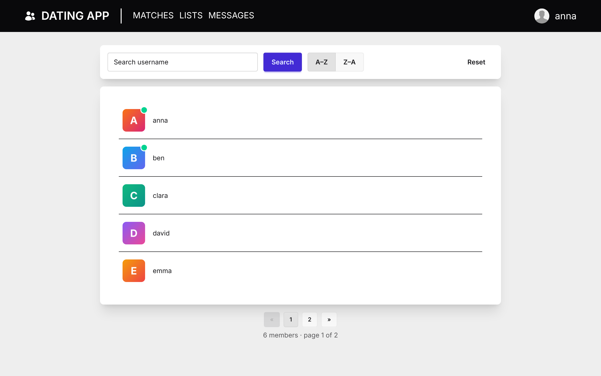
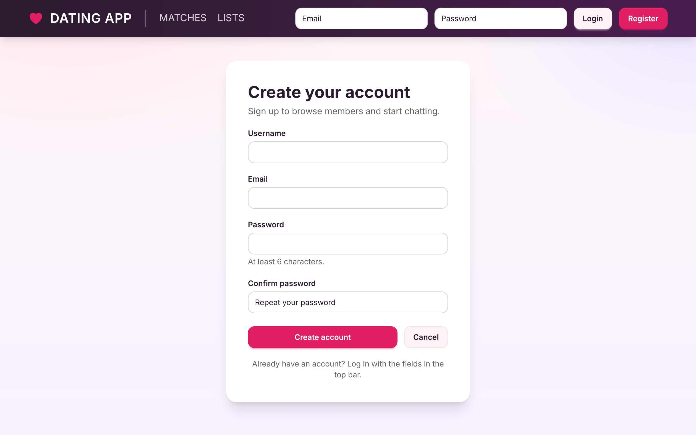
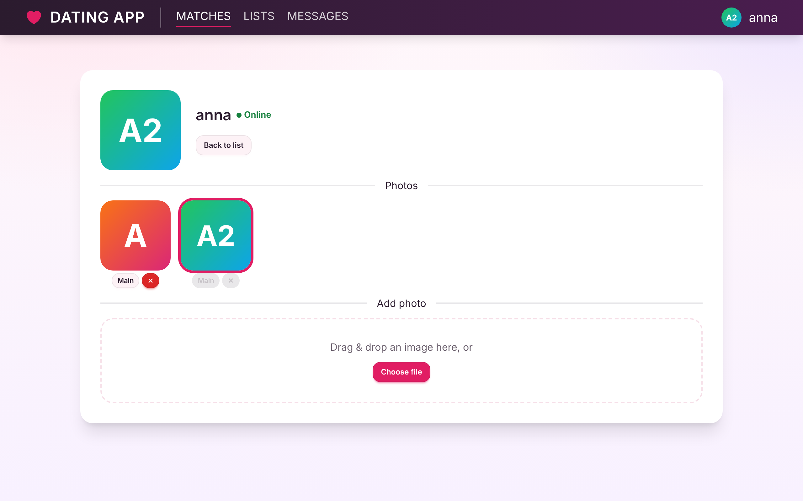
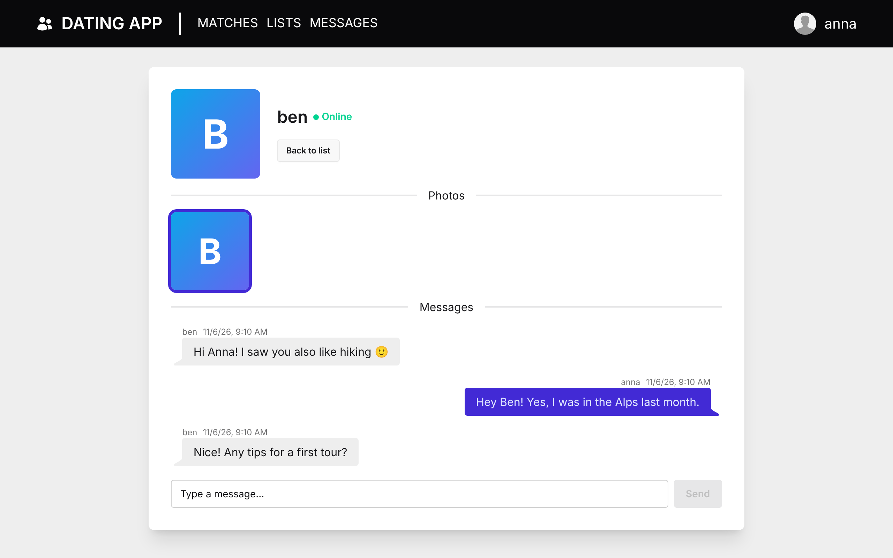
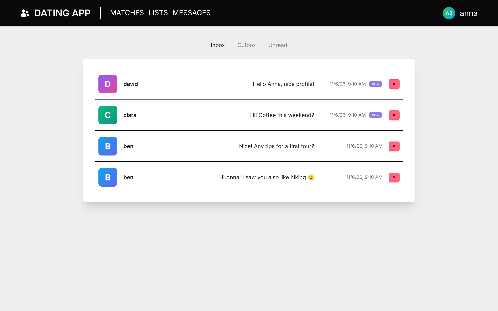
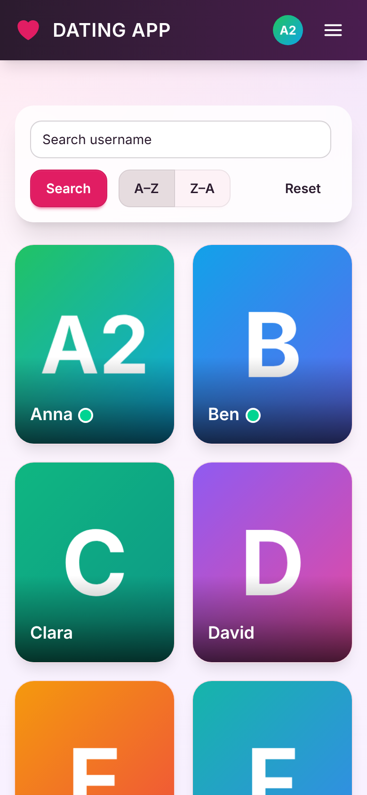
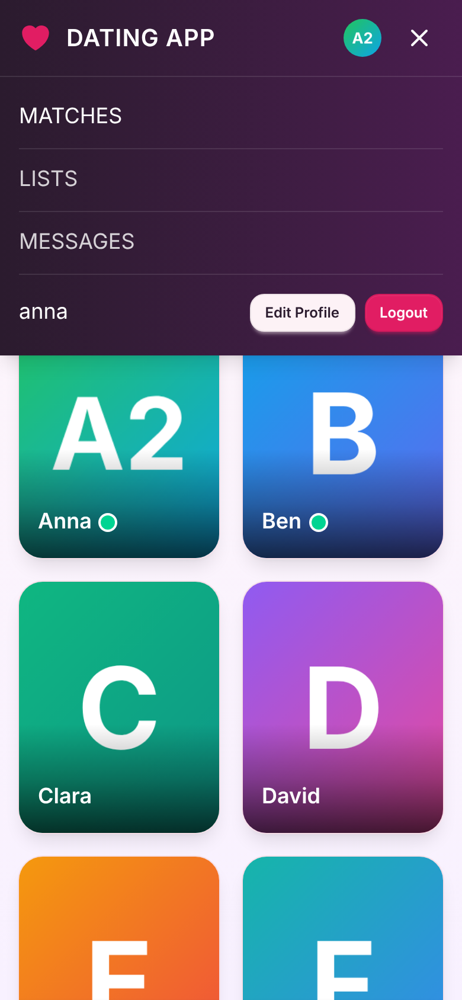

# 🧠 Fullstack Web App with .NET 9 & Angular 20


> 🚧 **Work in progress** – built step by step as part of my self-taught WebDev journey.

## 📝 Summary

A full-stack dating app with an **ASP.NET Core Web API** backend and an **Angular** single-page frontend.
Users can register and log in (JWT), browse other members in a photo grid with search, sorting and pagination,
upload profile photos via drag & drop, and chat with each other in real time via **SignalR** –
including a live online indicator. The UI uses a custom rose/plum theme and works on desktop, tablet and phone.

<p align="center">
  
  <br><b>Members</b>
</p>

<table>
  <tr>
    <td align="center" width="50%">
      
      <br><b>Register</b>
    </td>
    <td align="center" width="50%">
      
      <br><b>Profile &amp; photo upload</b>
    </td>
  </tr>
  <tr>
    <td align="center" width="50%">
      
      <br><b>Live chat with online status</b>
    </td>
    <td align="center" width="50%">
      
      <br><b>Messages (Inbox / Outbox / Unread)</b>
    </td>
  </tr>
</table>

<table>
  <tr>
    <td align="center">
      
      <br><b>Phone</b>
    </td>
    <td align="center">
      
      <br><b>Mobile menu</b>
    </td>
  </tr>
</table>

<sub>Screenshots use generated placeholder avatars and sample data.</sub>

---

## ▶️ Quick start

Prerequisites: [.NET 9 SDK](https://dotnet.microsoft.com/download) and [Node.js](https://nodejs.org/) (LTS).

```bash
# 1) API – https://localhost:5001 (the SQLite database is created automatically on first start)
cd API
dotnet dev-certs https --trust
dotnet run --launch-profile https
```

```bash
# 2) Client – http://localhost:4200
cd client
npm install
npm start
```

Open http://localhost:4200, click **Register** in the top bar and create your first account.

---

## ✨ Features

- **Accounts** – registration & login, JWT auth (HMACSHA512 password hashing), session kept in localStorage
- **Members** – photo grid with username search, A–Z / Z–A sorting and server-side pagination; member detail page
- **Photos** – drag & drop upload (jpg/png/gif/webp, max 10 MB), set main photo, delete
- **Messaging** – private messages with Inbox / Outbox / Unread views
- **Real-time** – SignalR hubs for online presence and live chat threads
- **UI** – custom daisyUI theme, responsive layout with a mobile menu below 1024 px
- **Error handling** – global API exception middleware, Angular error interceptor with toasts and error pages
- **Tests** – xUnit tests for the Account and Members controllers

## 🔧 Tech Stack

| Area | Technology |
|---|---|
| Frontend | Angular 20 (standalone components, signals, zoneless), Tailwind CSS 4, DaisyUI 5, ngx-toastr |
| Backend | ASP.NET Core Web API (.NET 9), SignalR, AutoMapper |
| Data | Entity Framework Core 9 (code first), SQLite |
| Testing | xUnit, EF Core InMemory |

## 🤖 How this project was built

I started this project by hand while learning ASP.NET Core and Angular: project setup,
authentication, the first API endpoints and the basic Angular structure.

Later features and refactorings were built with an AI coding assistant (Claude Code):
photo upload, messaging & SignalR, the registration form, the UI theme and the responsive layout.
I defined the requirements, reviewed designs and code, tested the results and decided what gets merged.
Commits created with the assistant are marked with `Co-Authored-By`.

## 🚀 Next steps

**Dating features**
- **Swiping** – card stack of profiles, swipe right to like / left to pass
- **Matches** – mutual likes become a match; the *Lists* page shows likes, liked-by and matches
- **Interests & hobbies** – pick interests on your profile, show them on the member card, filter members by shared interests
- **Richer profiles & editing** – bio, age, city, gender and "looking for"; wire up the *Edit Profile* menu entry
- **Discovery filters** – filter by age range, gender and distance

**Technical**
- Route guards for authenticated pages
- Cloud storage for photos (e.g. Cloudinary – swap `LocalFileStorageService` via `IFileStorageService`)
- Deployment-ready configuration (production settings, CORS, serving the SPA)
